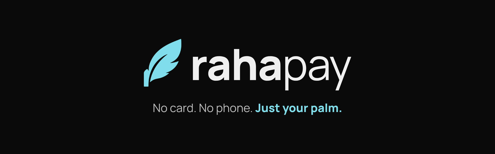

  

Raha Pay lets students pay at the school canteen with a palm scan. No card, no phone, no cash. Parents top up one wallet, set daily limits and see every purchase as it happens.

"Raha" means ease. Everything we build should feel that way.

### What we build

- **Parent app** for balances, limits, notifications and weekly spending insights
- **Canteen dashboard** for live sales, refunds and the daily close report
- **Palm reader integration** for schools, with biometric data kept on the reader system in Saudi Arabia

### Team

- **Ali Shamah**, Co-founder and CEO
- **Bahaa Najjar**, Co-founder and CTO

### Contact

[rahapay.app](https://rahapay.app) · hello@rahapay.app
